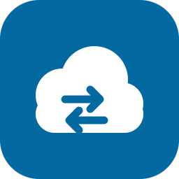
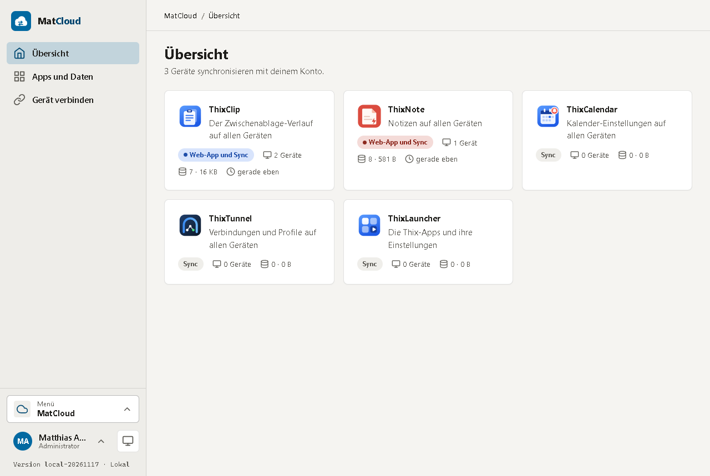
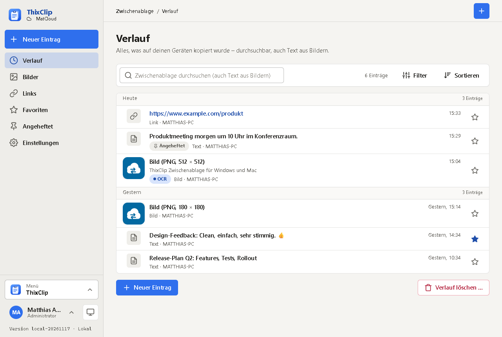
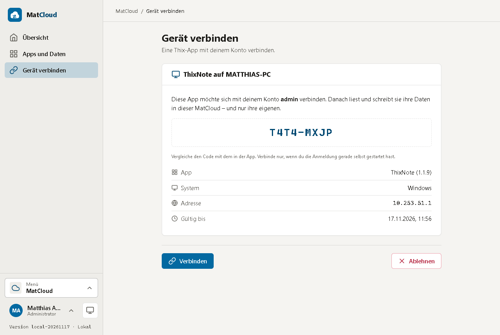
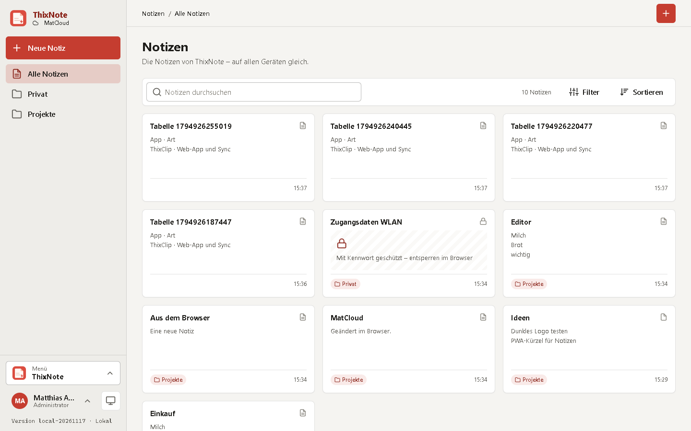
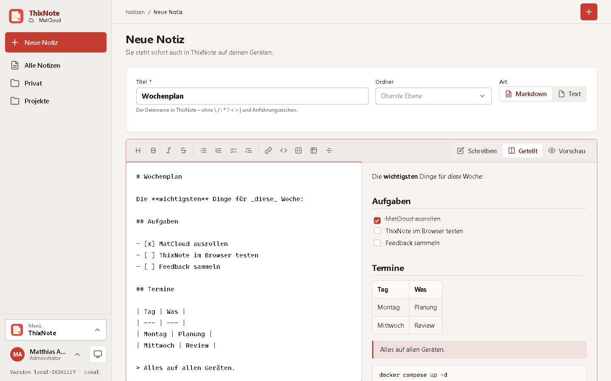
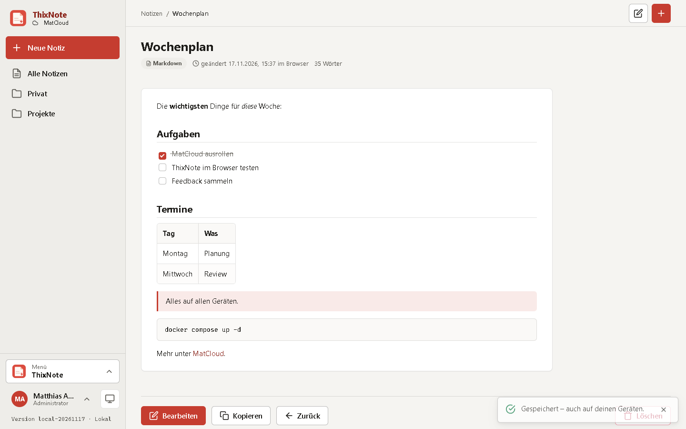
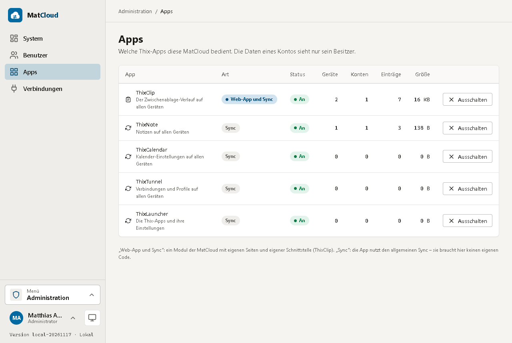
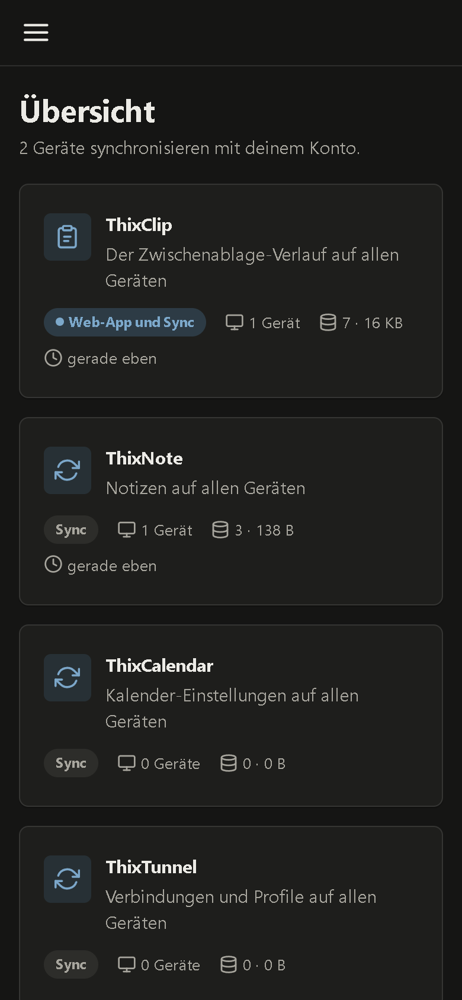

<div align="center">



# MatCloud

**The cloud of the Thix apps – your clipboard, notes and settings the same on every PC and Mac.**

Self-hosted, one container plus PostgreSQL. Every Thix app signs its devices in here; apps with a module get their own pages in the browser
(ThixClip: the clipboard history, ThixNote: the notes), every other app keeps its data in the general sync. An app of the Mat family: sign-in through MatIdentity,
installed and connected by Mattiverse – or on its own with `docker compose up`.

</div>



---

## What it does

| Area | What you get |
|---|---|
| **Devices per app** | Every Thix app on every computer is a device of your account; it reads and writes only its own data. Remove one and it stops at once. |
| **Sign-in in the browser** | The app shows a code and opens MatCloud; you confirm the code – also with an account of MatIdentity. Or sign in with user name and password. |
| **ThixClip** (module) | The clipboard history of all your computers: texts, links and pictures with their recognised text, searchable, live, favourites and pinned entries, "Verlauf löschen" like a browser, retention per account. |
| **ThixNote** (module) | The notes of all your computers in the browser, as cards: folders, search, Markdown drawn as a page, write, rename, move, delete – every device of ThixNote sees it at once. A real Markdown editor: toolbar and keys (Strg+B, Strg+K …), lists that continue themselves, a preview beside the text, Strg+S, a warning before unsaved text is left. Protected notes are opened and saved only in your browser with their password; the server never sees their text. |
| **Every app looks like itself** | `/Clip` is ThixClip, `/Note` is ThixNote: their logo and name at the top of the menu, their colour, their favicon – and each can be installed as an app of its own. |
| **General sync** | ThixNote (notes), ThixCalendar, ThixTunnel, ThixLauncher, ThixFred (the launcher: settings, themes, web searches, scripts, store plugins): their data the same everywhere – last change wins, deletions travel, nothing is missed (revisions + long poll). The cloud never reads it: protected notes stay encrypted. |
| **Apps und Daten** | What each app keeps for you, its devices, and "Daten in der Cloud löschen". |
| **Administration** | Accounts, which apps this cloud serves (switch one off: its devices stop, the data stays), the public address, the Connections of the platform. Administrators never see the data of others. |
| **Mat platform** | `/api` describes MatCloud to Mattiverse (tiles, settings, actions, the launcher with quick actions, two widgets), `/api/health` for Docker and the broker. |
| **PWA** | Installable, works at 390 px, light and dark, the last pages offline. |

| | |
|---|---|
|  |  |
|  |  |
|  |  |
|  | |

## Run it

| File | Stack | What | Addresses |
|---|---|---|---|
| `docker-compose.yml` | `matcloud` | Release (branch `main`), image `ghcr.io/real-ttx/matcloud:latest` | app http://localhost:4950 |
| `docker-compose.dev.yml` | `matcloud-dev` | Development (branch `dev`), image `:nightly`, plus pgAdmin | app :4950, pgAdmin :4951 |
| `docker-compose.local.yml` | `matcloud-local` | Built from this folder, plus pgAdmin, Postgres published | app :4950, pgAdmin :4951, Postgres :4952 |

```
docker compose up -d                                   # release
./scripts/redeploy.ps1                                 # local: rebuild the image and restart the local stack (-Clean also drops the volumes)
```

The first visit opens the **setup assistant**, which creates the administrator (with MatIdentity configured, the first person who signs in there is
the administrator). Then, in every Thix app: **Einstellungen › Cloud**, the address of this installation, **Im Browser anmelden**. For use over the
internet put a TLS proxy in front (Matcad, Caddy, nginx, Traefik; `X-Forwarded-*` are honoured).

### Settings (environment, all optional)

| Variable | Meaning |
|---|---|
| `MATCLOUD_DB` | the connection string of PostgreSQL (default: `Host=db;Port=5432;Database=matcloud;Username=matcloud;Password=matcloud`, fits the compose files) |
| `MATCLOUD_ADMIN_PASSWORD`, `MATCLOUD_ADMIN_USER` (default `admin`) | creates the administrator of a fresh installation (Mattiverse generates the password); without it the setup assistant does it |
| `MAT_API_KEY` | the key of `/api` (state, configure, actions, bindings) for a broker such as Mattiverse; without it only a token of MatIdentity is accepted |
| `MAT_PUBLIC_URL` | the public address (for the link of the sign-in in the browser); otherwise the setting in Administration › System, else the address of the request |
| `MATIDENTITY_AUTHORITY`, `MATIDENTITY_CLIENT_ID` (default `matcloud`), `MATIDENTITY_CLIENT_SECRET`, `MATIDENTITY_INTERNAL_URL` | sign-in through MatIdentity (OpenID Connect, back-channel logout); the local sign-in stays at `/Account/Login?local=1` |
| `MAT_FRAME_ANCESTORS` | the origins that may show MatCloud in a frame (Mattiverse) |

Volumes: `web-data` (`/data`: the keys that protect the sessions, the bindings of the platform) and `db-data` (the database).

## For developers

- [docs/ARCHITECTURE.md](docs/ARCHITECTURE.md) – platform, modules, accounts, data and sync
- [docs/CONTRACT.md](docs/CONTRACT.md) – the protocol for the apps (sign-in, general sync, ThixClip) and how an app copies the contract
- [docs/MODULES.md](docs/MODULES.md) – how an app gets a module of its own
- [CLAUDE.md](CLAUDE.md) – build, test, conventions

```
dotnet build MatCloud.slnx
$env:MATCLOUD_TEST_DB = "Host=localhost;Port=4952;Database=postgres;Username=matcloud;Password=matcloud"   # the Postgres of the local stack
dotnet test tests/MatCloud.Tests
cd tests/e2e; npm install; node run.js http://localhost:4950   # browser checks, screenshots in tests/e2e/shots
```

© Matthias Schmoldt
